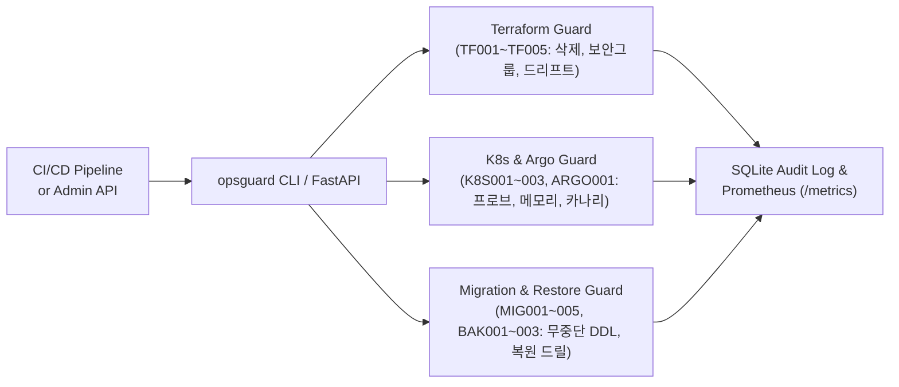

# opsguard

CI/CD 파이프라인 직전 단계에서 Terraform Plan의 파괴적 변경과 드리프트, Kubernetes 및 Argo Rollouts 매니페스트 오설정, 운영 DB 테이블 잠금을 유발하는 마이그레이션 DDL, 손상된 백업 덤프를 사전에 걸러내는 정적 검사기 겸 FastAPI 검증 서버입니다.

## 검사 항목 요약

| 규칙 ID | 심각도 | 영역 | 차단 조건 |
|---|---|---|---|
| `TF001` | ERROR | Terraform | `aws_db_instance`, `aws_s3_bucket`, `aws_ebs_volume` 삭제 또는 교체(`actions`에 `delete` 포함) |
| `TF002` | ERROR | Terraform | `aws_security_group` 인바운드에서 포트 `22`, `5432`, `6379`에 `0.0.0.0/0` 또는 `::/0` 허용 |
| `TF003` | ERROR | Terraform | `aws_db_instance`의 `storage_encrypted` 비활성화 또는 `backup_retention_period < 1` |
| `TF004` | ERROR | Terraform | 허용 목록 외의 고비용 컴퓨트 및 DB 인스턴스 타입 지정 |
| `TF005` | ERROR | Terraform | 선언 코드와 런타임 스냅샷 간 속성 불일치, 리소스 누락, 미관리(Shadow) 리소스 발견 |
| `K8S001` | ERROR | Kubernetes | 컨테이너 이미지 태그 생략 또는 `:latest` 지정 |
| `K8S002` | ERROR | Kubernetes | `resources.limits.memory` 또는 `resources.requests.memory` 설정 누락 |
| `K8S003` | ERROR | Kubernetes | `readinessProbe` 또는 `livenessProbe` 설정 누락 |
| `ARGO001` | ERROR | Argo Rollouts | `spec.strategy.canary.steps` 가중치 역전 또는 `analysis` 단계 누락 |
| `MIG001` | ERROR | Migration | Expand 단계에서 `DROP COLUMN`, `DROP TABLE` 실행 (`--allow-contract` 지정 시 허용) |
| `MIG002` | ERROR | Migration | 실행 중인 구버전 쿼리를 깨뜨리는 `RENAME COLUMN`, `RENAME TO` 실행 |
| `MIG003` | ERROR | Migration | 배타적 테이블 잠금과 전체 재작성을 유발하는 `ALTER COLUMN TYPE` 실행 |
| `MIG004` | ERROR | Migration | 테이블 잠금을 유발하는 `DEFAULT` 없는 `ADD COLUMN ... NOT NULL` 실행 |
| `MIG005` | ERROR | Migration | 쓰기 잠금을 유발하는 `CONCURRENTLY` 없는 인덱스 생성 및 삭제 |
| `BAK001` | ERROR | Backup Drill | 백업 덤프 파일의 SHA-256 해시 불일치 |
| `BAK002` | ERROR | Backup Drill | 복원 실행 실패, 필수 테이블 누락 또는 데이터 행 수 0건 |
| `BAK003` | ERROR | Backup Drill | 주문 및 결제 금액 컬럼에 음수 값 존재 또는 합계 음수 |

## 내부 구조



```text
opsguard/
├── models.py            Pydantic v2 정책 리포트 스키마 및 SQLAlchemy 2.0 감사 로그(AuditRecord) 모델
├── terraform_guard.py   Terraform Plan 파괴적 변경(TF001~004) 및 런타임 스냅샷 드리프트(TF005) 검증기
├── k8s_guard.py         Kubernetes 워크로드(K8S001~003) 및 Argo Rollouts 카나리(ARGO001) 매니페스트 검증기
├── migration_guard.py   PostgreSQL Expand-Contract DDL 린터(MIG001~005) 및 인메모리 복원 드릴(BAK001~003)
├── api.py               FastAPI 검증 엔드포인트, aiosqlite 감사 기록, Prometheus 메트릭 노출
└── cli.py               Typer 기반 CLI (terraform, k8s, migration, restore, serve)
tests/
└── test_opsguard.py     16개 정책 규칙, 인메모리 복원 드릴, FastAPI 비동기 감사 기록 및 CLI 통합 검증
```

DDL 린터(`migration_guard.py`)는 주석을 제거한 SQL 문장을 분석해 구버전 컨테이너가 떠 있는 Expand 단계(`allow_contract=False`)에서는 `DROP` 구문을 막고 `--allow-contract` 지정 시에만 허용합니다. 백업 복원 드릴(`verify_backup_restore_drill`)은 SHA-256 검증 후 격리된 인메모리 SQLite에 덤프를 직접 실행해 테이블 존재, 최소 행 수, 금액 컬럼 음수 여부를 확인합니다. 모든 API 검증 이력은 `aiosqlite`를 통해 `audit_records` 테이블에 저장하고 `/metrics`로 노출합니다.

## CLI 및 서버 사용법

```bash
# Terraform Plan JSON 검사
opsguard terraform plan.json

# Terraform 런타임 드리프트 검사
opsguard terraform desired.json --actual actual.json

# Kubernetes / Argo Rollouts 매니페스트 검사
opsguard k8s deployment.yaml

# SQL 무중단 마이그레이션 린트 (Expand / Contract 단계)
opsguard migration migration.sql
opsguard migration migration.sql --allow-contract

# 백업 덤프 복원 드릴 검증
opsguard restore dump.sql --sha256 <expected-hash> --table users --table orders

# FastAPI 검증 서버 기동
opsguard serve --host 0.0.0.0 --port 8004
```

HTTP API 엔드포인트:
- `POST /v1/verify/terraform`
- `POST /v1/verify/k8s`
- `POST /v1/verify/migration`
- `POST /v1/verify/restore`
- `GET /healthz`, `GET /metrics`

## 테스트

```bash
make check
# 또는 개별 실행
ruff check opsguard tests
mypy opsguard tests
pytest -v tests/
```

SQL 린터는 정규화한 DDL 구문 패턴을 정적으로 검사하므로 PL/pgSQL 함수 본문이나 `EXECUTE` 동적 문자열 내부의 DDL은 별도 검토가 필요합니다. 또한 백업 복원 드릴은 외부 DB 없이 빠르게 검증하기 위해 인메모리 SQLite를 사용하므로 `COPY ... FROM stdin` 같은 PostgreSQL 고유 문법이 포함된 바이너리 덤프는 임시 PostgreSQL 인스턴스에서 검증해야 합니다.
